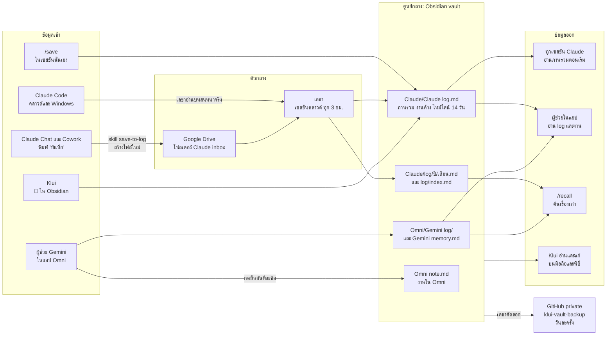
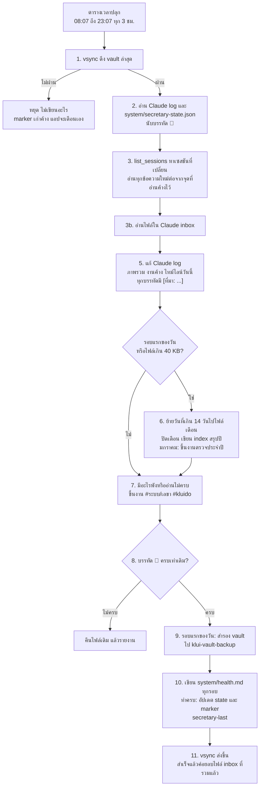
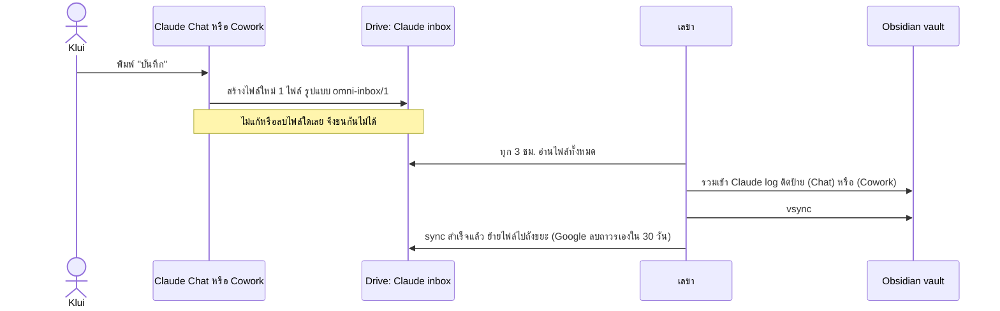
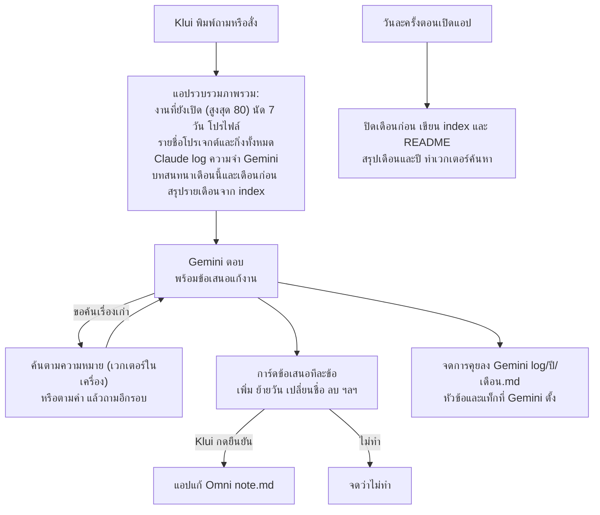
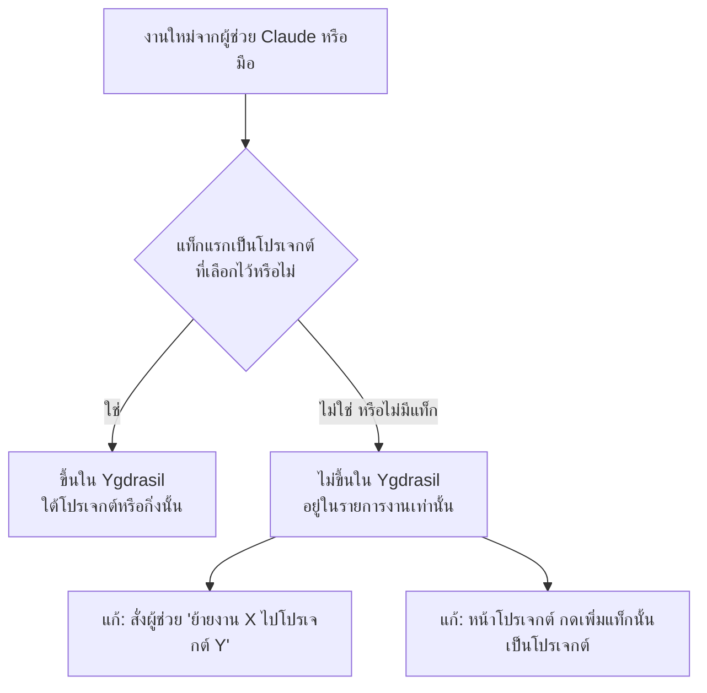
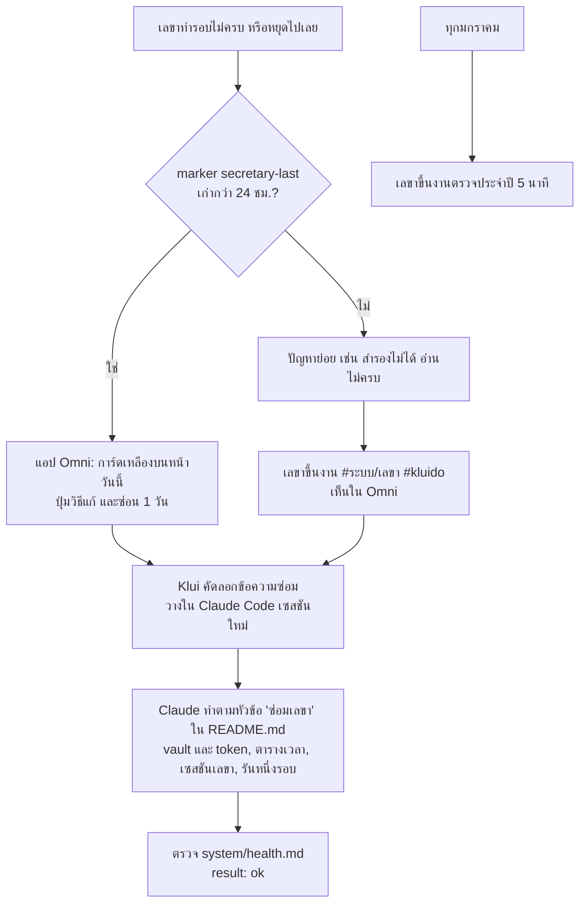

# แผนผังระบบเลขาและบันทึกงาน

ไฟล์นี้อธิบายว่าทั้งระบบทำงานยังไง ใครเขียนอะไร เก็บที่ไหน และแก้ตรงไหน สำหรับ Klui และสำหรับ AI ที่มาซ่อมหรือปรับในอนาคต แผนภาพเขียนด้วย Mermaid ซึ่ง Obsidian และ GitHub วาดให้เอง ถ้าโปรแกรมในอนาคตวาดไม่ได้ ข้อความในกล่องก็ยังอ่านรู้เรื่อง

สำเนาของไฟล์นี้และไฟล์อื่นในโฟลเดอร์ Claude อยู่ใน repo `klui2543/omni-task` ที่ `docs/vault/Claude/` เมื่อแก้ระบบ ให้แก้ทั้งสองที่ให้ตรงกัน

## 1. ภาพรวม: ข้อมูลเข้า ศูนย์กลาง ข้อมูลออก



## 2. หนึ่งรอบของเลขา

ขั้นตอนเต็มอยู่ใน `secretary.md` (เลขาอ่านไฟล์นั้นใหม่ทุกรอบ) แผนภาพนี้คือโครงของมัน



## 3. กล่องจดหมายจาก Claude Chat และ Cowork

Chat และ Cowork เขียนเข้า vault ไม่ได้ และเลขาอ่านแชตเหล่านั้นไม่ได้ (ทดสอบแล้ว 2026-10-22: งานตั้งเวลาของ Cowork ไม่มีเครื่องมือค้นแชตเก่า) จึงต้องพิมพ์ "บันทึก" เอง แชตเล็ก ๆ และโหมดเสียงไม่ต้องบันทึก



รูปแบบไฟล์ (อยู่ใน skill `save-to-log`, สำเนาที่ `docs/vault/chat-skill/` ใน repo omni-task):

```
omni-inbox/1
from: chat
saved: 2026-10-21T21:40:00+07:00
project: siriraj/ป้าย

## ภาพรวม
- siriraj/ป้าย: ถึงไหน ➜ ใครทำต่อ

## งานค้าง
- [ ] #siriraj/ป้าย #kluido สิ่งที่ Klui ต้องทำ

## ไทม์ไลน์
- ทำอะไร ตัดสินใจอะไรเพราะอะไร
```

## 4. ผู้ช่วย Gemini ในแอป Omni



## 5. กติกาแท็กโปรเจกต์ (ทำไมงานถึงขึ้นหรือไม่ขึ้นใน Ygdrasil)

Ygdrasil และหน้าโปรเจกต์แสดงเฉพาะงานที่ **แท็กแรก** เป็นโปรเจกต์ที่ Klui เลือกไว้ในหน้าโปรเจกต์ แท็กอื่นเป็นแท็กธรรมดา กิ่งเขียนต่อด้วย `/` เช่น `#peddose/แอป/มือถือ`



- ผู้ช่วยในแอปได้รับรายชื่อโปรเจกต์และกิ่งทั้งหมดทุกครั้ง และต้องเลือกจากรายการนั้น ไม่แน่ใจต้องถาม (`AiAssist.projectList` และกติกาใน `CHAT_ASK`, repo omni-task `shared/.../model/AiAssist.kt`)
- ถ้า Klui กดยืนยันงานที่ใช้โปรเจกต์ใหม่ แอปเพิ่มโปรเจกต์นั้นเข้ารายการที่เลือกไว้เอง (`keepProject` ใน `TaskViewModel.kt`)
- Claude ที่เพิ่มงานลง `Omni note.md` ใส่แท็กโปรเจกต์ก่อน แล้ว `#kluido` ตามกติกาใน `CLAUDE.md` ยกเว้นงานจากไฟล์ที่ Klui แนบในห้องเลขา (ทางเร่ง: export จาก Live แล้วพิมพ์ "รอบเลขา") เลขาเพิ่มเป็นบรรทัดเปล่า `- [ ] งาน ➕ วันที่` ไม่มีแท็ก ให้ขึ้นถาด "ยังไม่มีบ้าน" ในแอป

## 6. ตรวจจับปัญหาและซ่อม



## 7. ไฟล์ไหน ใครเขียน แก้ตรงไหน

| ไฟล์หรือที่เก็บ | ใครเขียน | ใช้ทำอะไร |
|---|---|---|
| `Claude/Claude log.md` | เลขา, `/save`, Klui (💬) | ภาพรวมทุกโปรเจกต์ งานค้าง ไทม์ไลน์ 14 วัน |
| `Claude/log/<ปี>/<MM Mon>.md` | เลขา (ย้ายข้อความมาตามเดิม) | วันเก่าและงานที่เสร็จ |
| `Claude/log/index.md` | เลขา | สารบัญรายเดือนและสรุปปี |
| `Claude/system/health.md` | เลขา ทุกรอบ | ผลรอบล่าสุด สำรองล่าสุด ปัญหา |
| `Claude/system/secretary-state.json` | เลขา | อ่านเซสชันไหนถึงข้อความไหนแล้ว (ห้ามแก้) |
| `Claude/secretary.md` | Klui หรือ Claude ตอนซ่อม | ขั้นตอนของเลขา |
| `Claude/CLAUDE.md` | Klui หรือ Claude เมื่อสั่ง | กติกาทุกเซสชัน (setup script คัดลอกไป `~/.claude`) |
| `Claude/README.md` | Claude เมื่อสั่ง | อะไรอยู่ไหน วิธีค้น วิธีซ่อม ตรวจประจำปี กู้ backup |
| `Claude/commands/` | Claude เมื่อสั่ง | `/save` และ `/recall` |
| `Omni/Gemini log/` และ `Gemini memory.md` | แอป Omni | การคุยกับผู้ช่วย สารบัญ README ความจำ |
| Drive `Claude inbox` | skill `save-to-log` | จุดพักชั่วคราวจาก Chat และ Cowork |
| GitHub `klui-vault-backup` | เลขา วันละครั้ง | สำเนา vault ทั้งหมด ย้อนวันไหนก็ได้ |
| ตารางเวลา (scheduled task) ของเลขา | ตั้งในเซสชันเลขาเท่านั้น | ปลุกเลขา cron `CRON_TZ=Asia/Bangkok 7 8-23/3 * * *` |
| Setup script ของ environment "Default" | Klui ในหน้าตั้งค่า | ติดตั้ง ob, ต่อ vault, สร้าง vsync, คัดลอกกติกาและคำสั่ง (มี token อยู่ที่นี่เท่านั้น) |

## 8. อยากเปลี่ยนอะไร แก้ที่ไหน

| อยากเปลี่ยน | แก้ที่ |
|---|---|
| สิ่งที่เลขาทำในแต่ละรอบ | `Claude/secretary.md` (มีผลรอบถัดไป) |
| เวลาที่เลขารัน | พิมพ์สั่งในเซสชัน "เลขา (รันทุก 3 ชั่วโมง)" ให้แก้ตารางเวลาของตัวเอง |
| กติกาที่ทุกเซสชัน Claude ต้องทำ | `Claude/CLAUDE.md` แล้วเปิดเซสชันใหม่ |
| รูปแบบที่ Chat บันทึก | skill `save-to-log` ใน repo แล้วอัปโหลดทับใน claude.ai |
| สิ่งที่ผู้ช่วยในแอปรู้หรือทำได้ | repo omni-task `shared/.../model/AiAssist.kt` แล้วสร้าง APK ใหม่ |
| การเก็บและค้น Gemini log | repo omni-task `AiMemory.kt`, `AiIndex.kt`, `app/.../data/AiLibrary.kt` |
| การ์ดเตือนเลขาหยุด | repo omni-task `app/.../ui/SecretaryUi.kt` |
| token ของ Obsidian หมดอายุ | ขอ token ใหม่ แล้ววางใน Setup script ของ environment (ไม่วางในแชต) |
